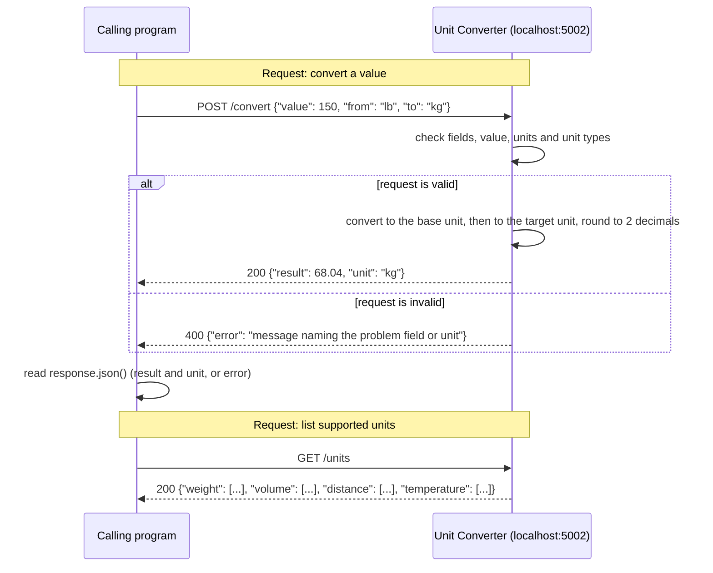

# Unit Converter Microservice

## What it does

A small REST API that converts a number from one unit to another. Any program that can send HTTP and JSON can call it.

**Supported units** (names are not case-sensitive):

| Type | Units |
|---|---|
| weight | `g`, `kg`, `oz`, `lb` |
| volume (US) | `ml`, `l`, `tsp`, `tbsp`, `cup`, `fl_oz` |
| distance | `m`, `km`, `ft`, `mi` |
| temperature | `c` (Celsius), `f` (Fahrenheit), `k` (Kelvin) |

Units can only be converted within the same type (lb to kg works, lb to ml does not). Results are rounded to 2 decimals. Converting a unit to itself returns the value unchanged.

## Run it

```
pip install -r requirements.txt
python app.py
```
It listens on http://localhost:5002 (set the `PORT` environment variable to change this).

## How to REQUEST data

**Convert a value:** send `POST /convert` with a JSON body (Content-Type: application/json):

| Field | Type | Meaning |
|---|---|---|
| value | number | the number to convert |
| from | string | the unit to convert from, e.g. `"lb"` |
| to | string | the unit to convert to, e.g. `"kg"` |

**List the supported units:** send `GET /units` (no parameters).

Example call (Python):
```python
import requests

microservice_url = "http://localhost:5002/convert"
response = requests.post(microservice_url, json={"value": 150, "from": "lb", "to": "kg"})

units_response = requests.get("http://localhost:5002/units")
```

## How to RECEIVE data

Every response is JSON (Content-Type: application/json).

- **Success (status 200):** `{"result": 68.04, "unit": "kg"}`
- **`GET /units` (status 200):** `{"weight": ["g", "kg", "oz", "lb"], "volume": [...], "distance": [...], "temperature": ["c", "f", "k"]}`
- **Failure (status 400):** `{"error": "..."}`. The message names the problem field or unit. It is returned for a missing field, a `value` that is not a number, an unsupported unit (the message lists the supported ones), units of different types, or a temperature below absolute zero.
- Unknown URLs return status 404 and wrong HTTP methods return 405, both with an `{"error": "..."}` body.

Example call (Python):
```python
if response.status_code == 200:
    data = response.json()
    print(data["result"], data["unit"])      # 68.04 kg
else:
    print("Unit converter failure:", response.json()["error"])

if units_response.status_code == 200:
    print(units_response.json()["weight"])   # ['g', 'kg', 'oz', 'lb']
```

## UML sequence diagram



## Test it

- Unit tests (28 hand-calculated conversions and the error cases): `python -m unittest -v`
- Test program that calls the running microservice over HTTP and prints the responses: start `python app.py`, then in another terminal run `python test_client.py`
